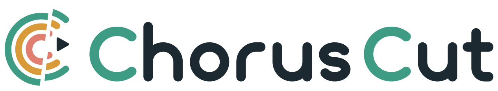
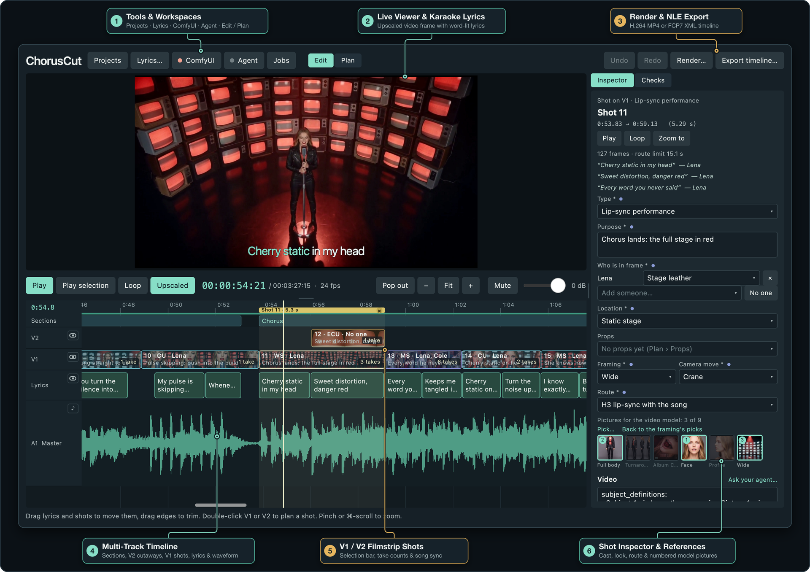
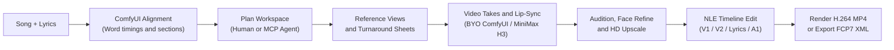
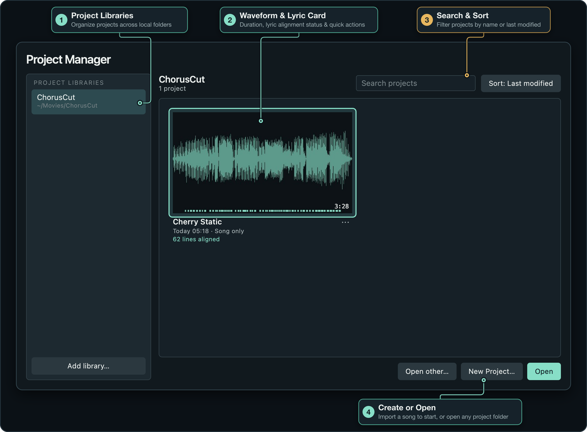
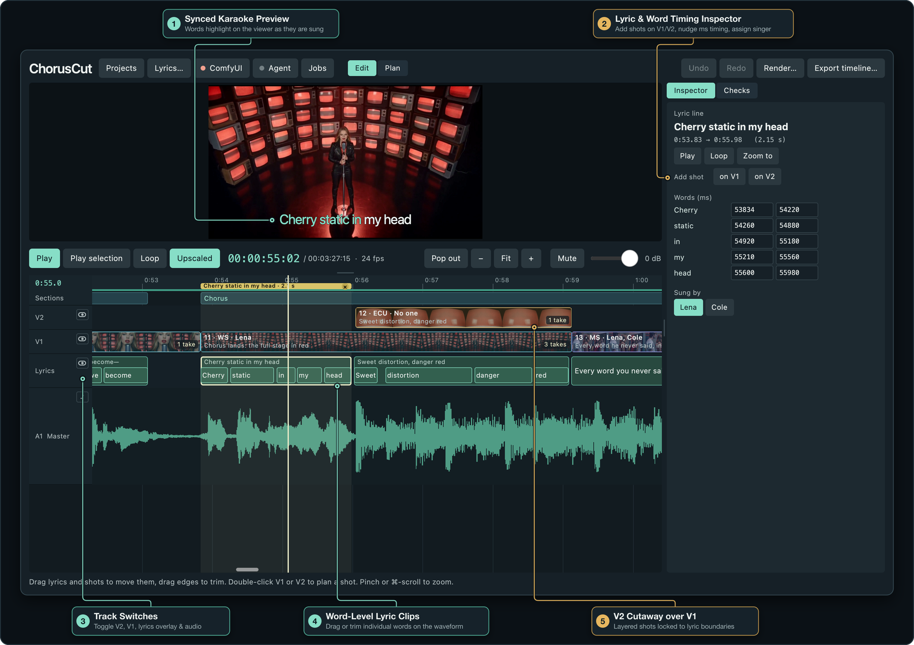
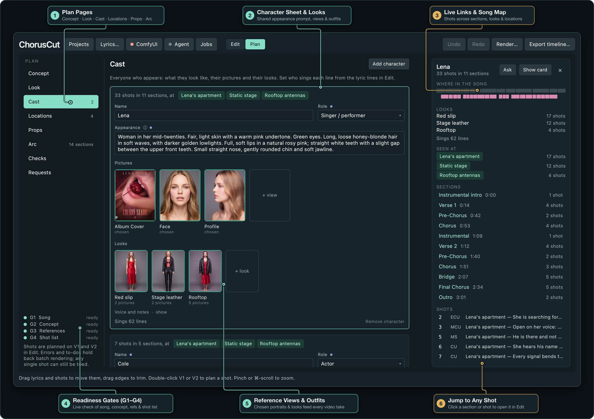
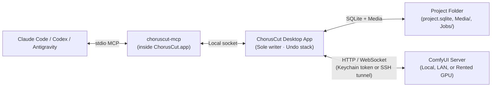
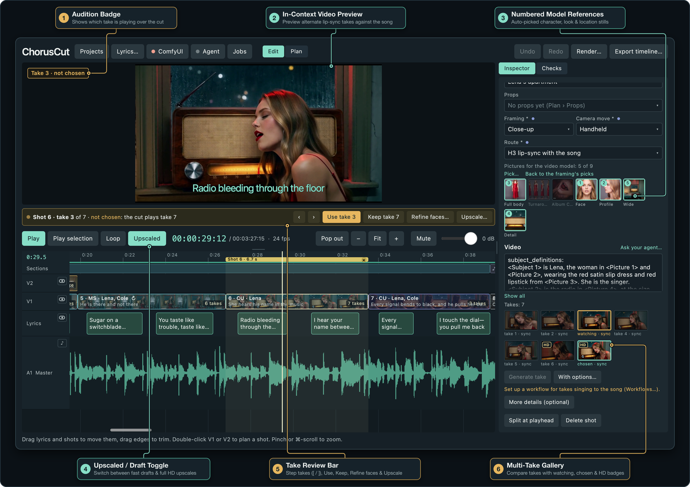

<p align="center">
  <picture>
    <source media="(prefers-color-scheme: dark)" srcset="resources/logo/lockup-dark.svg">
    <source media="(prefers-color-scheme: light)" srcset="resources/logo/lockup-light.svg">
    
  </picture>
</p>

<p align="center">
  <strong>A desktop music-video editor built around word-level lyric alignment, structured pre-production, bring-your-own ComfyUI generation, and a real NLE timeline.</strong>
</p>

<p align="center">
  macOS (Apple Silicon) today &middot; Windows and Linux planned
</p>

<p align="center">
  <a href="#how-it-works">How It Works</a> &middot;
  <a href="#features">Features</a> &middot;
  <a href="#ai-agents-mcp">AI Agents</a> &middot;
  <a href="#comfyui-and-workflows">ComfyUI &amp; Workflows</a> &middot;
  <a href="#installation">Install</a> &middot;
  <a href="#keyboard-shortcuts">Shortcuts</a> &middot;
  <a href="#build-from-source-macos">Build</a>
</p>

---

Most AI video tools treat a music video as a pile of disconnected prompts and text files. By the time you regenerate a shot, fix a lip-sync phrase, or swap a cutaway, your timing, character references, and editorial cut have drifted apart.

ChorusCut keeps the whole production in one local project folder: the master song, word-level lyrics, creative plan, cast and location references, generated takes, and the cut itself. You can plan every shot by hand or co-direct with Claude Code, Codex, or Google Antigravity over MCP. Heavy GPU work — lyric alignment, reference stills, lip-synced video takes, face refinement, and upscaling — runs through your own ComfyUI graphs on whatever local or rented GPU you point it at. Once media lands in the project, you cut it on a timeline that behaves like a real NLE, then render an H.264 MP4 directly or hand off an editable Final Cut Pro 7 XML sequence to DaVinci Resolve, Adobe Premiere Pro, or FilmCraft.



*The Edit workspace on a finished 42-shot project (`Cherry Static`): (1) toolbar and workspace switcher, (2) GPU-scaled viewer with live word-lit lyrics, (3) MP4 render and FCP7 XML export, (4) five-track NLE timeline, (5) V1/V2 filmstrip shots with selection bar and take counts, and (6) Shot Inspector with cast, look, route, and numbered reference stills.*

---

## How It Works

Every ChorusCut project is a plain folder (`project.sqlite`, `Media/`, `Jobs/`, `Renders/`, and `.thumbnail.jpg`). There is no cloud database, no proprietary subscription backend, and no bundled PyTorch runtime. One C++ command layer owns every mutation — timeline trims, word timing tweaks, plan edits, and agent passes all share immediate SQLite persistence and a unified undo stack.



A single assembly pipeline drives playback, MP4 rendering, and XML export, so what you watch in the viewer is what you render and what lands in Resolve or Premiere.

---

## Features

### Project Manager

ChorusCut opens in a Resolve-style **Project Manager**. Project libraries on the left are plain folders on disk (defaulting to `~/Movies/ChorusCut`, with **Add library…** for any other location). Because each project is self-contained, you can move, duplicate, back up, or archive folders directly.



*(1) Folder-based project libraries, (2) project card showing waveform, duration, and lyric alignment status, (3) live search and sort by modified date or name, and (4) New Project / Open controls.*

- **New Project…** imports your song (`.wav`, `.aif`, `.aiff`, `.flac`, `.mp3`, `.m4a`) into a fresh project folder, optionally accepts pasted lyrics and a language, and kicks off ComfyUI alignment immediately if a server is connected.
- **Project cards** display a generated `.thumbnail.jpg` combining a frame (or black), the song waveform, and lyric lines along the bottom, alongside song length, last-modified time, and alignment status (mint when aligned, amber when lines still need checking).
- **Quick actions** via right-click or `•••`: **Open**, **Rename…**, **Duplicate**, **Show in Finder**, and **Move to Trash…** (`⌘⌫`). **Open other…** opens any project folder outside your libraries. Press `⌘O` or click **Projects** from the editor to switch projects; press `Esc` to return.

---

### Song and Word-Level Lyric Alignment

Open **Lyrics…**, paste the lyrics as sung (repeating each chorus and placing `[Verse 1]`, `[Chorus]`, or `[Bridge]` headings on their own lines), pick a language (**English**, **French**, **German**, or **Spanish**), and click **Align**.

Alignment runs on your ComfyUI server via the bundled [`comfyui/ComfyUI-ChorusCut`](comfyui/ComfyUI-ChorusCut) node pack (`ChorusCutAlignLyrics`):

1. Separates vocals in-process with **Mel-Band RoFormer**.
2. Runs whole-song CTC forced alignment across multiple acoustic voters (Parakeet CTC 0.6B, wav2vec2-large, and XLSR-53 on vocals plus full mix for English; XLSR-53 vocal + mix for French, German, and Spanish).
3. Takes a per-line majority vote, extends held notes using vocal RMS energy, and detects instrumental intros, breaks, and outros (`♪`).
4. Flags lines where voters disagreed in **amber** so you can jump straight to doubtful lines and click **Mark checked** once verified.

Zoomed out, the **Lyrics** track wraps each line cleanly onto multiple rows. Zoom in (pinch, `⌘`-scroll, or `⌘=`) and once at least half of a line's words fit in full, it expands into draggable, trimmable **word clips** beneath a line-move strip. You can also nudge start and end times to the millisecond in the Inspector, assign who sings each line, load a saved alignment JSON via **Import alignment…**, or fall back to **Basic offline align** (an older local single-model English aligner that runs without ComfyUI).



*(1) Karaoke preview lighting words as they are sung, (2) Lyric Inspector with per-word millisecond timing, singer toggles, and one-click Add shot on V1/V2, (3) per-track visibility and mute switches, (4) draggable/trimmable word clips over the master waveform, and (5) a V2 cutaway layered cleanly over a V1 performance shot.*

Every alignment job is recorded in `project.sqlite` and written to `Jobs/` before being applied. If you close the project, quit the app, or lose your GPU tunnel mid-run, reopening the project resumes the job automatically. If you edit the lyrics while a job is running, the result is still saved to `Jobs/` without overwriting your edits.

---

### Pre-Production Planner, Reference Views, and Sheets

Switch between **Edit** (`⌘1`) and **Plan** (`⌘2`) at any time. The **Plan** workspace organizes pre-production top-down across eight pages:

- **Concept:** Your brief (append-only for agents), logline, video kind (`Performance`, `Narrative`, `Abstract`, `Mixed`), mix ratio, treatment, and format (aspect ratio `16:9`, `9:16`, `1:1`, `4:5`, `2.39:1`, delivery resolution, and frame rate).
- **Look:** Visual style, palette, lighting, era, lens feel, grade intent, and explicit must/must-not rules.
- **Cast:** Characters (name, role, shared appearance prompt, and reusable face-refine prompt) plus nested **Looks** for wardrobe, hair, and makeup variants. Each look tracks what it **keeps from character** (`Face`, `Hair`, `Build`, `Skin`) — turning off `Hair` for a wet-hair look tells both prompts and reference pickers not to leak dry-hair portraits into that scene.
- **Locations & Props:** Environments (with time of day and lighting) and recurring objects or motifs, each with their own appearance prompt and reference views.
- **Arc:** Section-by-section story beats and cut pacing (`slow`, `medium`, `fast`), locked to the song's real sections and instrumental spans in order.
- **Checks & Readiness Gates (G1–G4):** Continuous validation across **G1 Song**, **G2 Concept**, **G3 References**, and **G4 Shot list**. Checks catch unaligned or flagged lines, missing singers, missing chosen reference stills, timeline coverage gaps, lip-sync shots over instrumentals or missing their singer, shots exceeding the route's frame limit (offering one-click **Split at lines**), and shots with more than 9 references. Gates are soft: any individual shot can be tested early.
- **Requests:** Persistent conversation threads tied to specific plan fields, views, or shots.



*(1) Plan sidebar pages, (2) character card with shared appearance prompt, reference views, and looks, (3) docked Links panel mapping every shot, look, location, and section for the selected item, (4) live G1–G4 readiness gates, (5) chosen portraits and outfit looks fed to video generation, and (6) click-to-jump links straight into Edit.*

#### Reference Views and Composed Sheets

Instead of rewriting prompts for every angle, each character, look, location, and prop has **one subject appearance** and multiple **Views** (for example: *Face*, *Three-quarter*, *Profile*, *Full body*, and *Turnaround sheet* for characters; *Wide*, *Reverse angle*, *Detail*, and *Angles sheet* for locations). Each view holds one **chosen** picture plus any number of dimmed alternatives you can inspect in the full-size Reference Viewer or drag-and-drop to import.

Because reference-to-video models cap how many images a shot can take (MiniMax H3 accepts up to 9), ChorusCut supports **Sheets** in two ways:
- **Compose from views…:** Instantly composites your ticked chosen views into a clean row or grid right on CPU — no GPU cost, and no text labels by default so text doesn't bleed into video renders.
- **Generate via workflow:** Generate a turnaround, outfit, or angles sheet directly through your text-to-image or image-edit ComfyUI workflow.

Clicking any character, location, prop, or section card updates the docked **Links** panel (with `⌘[` back navigation) to show everywhere it appears in the song; clicking any shot jumps directly to it in **Edit**. Every field tracks `user` vs `agent` provenance and offers a hover **Lock** button.

---

### AI Agents (MCP)

ChorusCut ships a local stdio MCP server (`choruscut-mcp`) inside `ChorusCut.app`. It connects to the running app over a per-user local socket (`QLocalServer`), so you use your existing **Claude Code**, **Codex**, or **Google Antigravity** subscription with no separate model API keys and no external cloud relay.



Because ChorusCut stays the sole writer of `project.sqlite`:
- **Every agent pass is one atomic undo step.** A banner shows what the agent changed with a one-click **Undo** button (`⌘Z` works too).
- **Your edits stay yours.** In default `agent` mode, agents only fill empty or agent-owned fields — they never overwrite fields you wrote, never touch locked fields, and cannot silently swap your chosen pictures or takes.
- **Contextual agent requests:** Click **ask** on any plan field, **Ask** on a view or Links item, or **Ask your agent…** in the Shot Inspector to open a composer with field-tailored prompt suggestions. When running Claude Code with channels enabled (`claude --dangerously-load-development-channels server:ChorusCut`), `choruscut-mcp` pushes each request directly to your live session. With Codex, Antigravity, or standard Claude Code, requests queue in **Plan ▸ Requests** and surface via `get_requests`.

The MCP server exposes 11 tools: `get_guide`, `get_project`, `get_song`, `get_plan`, `get_checks`, `get_schema`, `view_reference` (so vision-capable agents can inspect your actual cast and location images before writing edit or video prompts), `apply_plan`, `get_requests`, `reply_request`, and `ask_user` (which surfaces clickable multiple-choice questions right inside the app). Claude Code also gets a built-in `/mcp__ChorusCut__plan` prompt.

---

### ComfyUI and Workflows

ChorusCut does not hardcode models or lock you into a fixed graph. Open **ComfyUI ▸ Workflows…** and import any ComfyUI workflow exported via **Workflow ▸ Export (API)**. Workflows live in one app-wide library (`workflow.json` + `adapter.json`), and every queued job snapshots the exact graph into `project.sqlite` so later edits to a workflow never break provenance for earlier pictures or takes.

On import, ChorusCut inspects the graph and maps input slots automatically — prompts, negative prompts, ordered reference images (up to 9 for video takes, pruning unused optional `LoadImage` nodes via `/object_info`), seed, width/height, file prefix, `LoadAudio` song excerpt, frame/second length, input video file, and face-detection reference image. Any sampler or workflow parameter (steps, CFG, guidance, megapixels, aspect ratio, face-refine strength) can be marked **Adjust when generating** so it appears live in the app's dialogs, and you can customize how pictures are named in prompts (for example `<Picture {n}>`) along with notes for your agent.

Seven workflow uses are supported:
1. **Reference picture from a prompt** (text-to-image)
2. **Reference picture from pictures** (image editing from picked references)
3. **Reference picture, from a prompt or from pictures** (combined graph with optional inputs)
4. **Shot take from reference pictures** (reference-to-video)
5. **Shot take singing to the song** (lip-sync reference-to-video with locked audio)
6. **Refine faces on a take** (per-character face redraw)
7. **Upscale a take** (full-take HD latent/video upscale)

#### Tested Production Stack: MiniMax H3

While any compatible API-format ComfyUI graph can be adapted, ChorusCut has been tested end-to-end on rented RTX 4090 GPUs with the **MiniMax H3** stack:
- **Reference images & edits:** MiniMax H3 Image (text and multi-reference edit; also tested with Qwen-Image / Qwen-Image-Edit graphs).
- **Video takes (`ref2v`):** MiniMax H3 Reference-to-Video at 24 fps (`5 + 17n` frame grid, up to 362 frames / 15.1 s, up to 9 `<Picture n>` references). ChorusCut adds configurable 0.5 s handles on each side and rounds cleanly onto the grid so you have room to trim on the timeline.
- **Lip-sync:** MiniMax H3 Reference-to-Video paired with **ComfyUI-Pixaroma's H3 Audio Sync** node fed by `LoadAudio`. ChorusCut slices the exact WAV excerpt (including handles) from the master recording and sends it to the node; prompts quote the sung lines verbatim without `<Audio n>`, and finished takes play muted under the master song.
- **Face refine:** `comfyui-h3-facerefine` / `-plus` (`H3FaceSelect`, `H3FaceRefineStrength`, `H3 Audio Sync`, VHS **Load Video FFmpeg (Upload)**, and `LoadAudio`).
- **Upscaling:** `MinimaxH3LatentUpscaler3D` (megapixels mode, align-32) with VHS **Load Video FFmpeg (Upload)** and `LoadAudio`.
- **Live generation previews:** **ComfyUI-KJNodes** (`ModelPreviewOverrideKJ`) with the H3 tiny VAE (`taeh3.safetensors` in `ComfyUI/models/vae_approx/`).

---

### Generation, Live Previews, Auditioning, Face Refine, and Upscaling

#### Reference Picture Generation
Generate stills directly from a view row or open **Generate ▸ With options…** to switch between **From the picture prompt** and **From pictures you pick**, arrange reference images in exact order, inspect the numbered sending strip, and rest the pointer over any tile for a large, uncropped hover preview showing owner and view name. Aspect ratio defaults automatically to 3:4 for people/looks and the project's video aspect for locations until you override it. **Save** keeps your picks and prompt without queueing; **Ask** sends the exact ordered picture list to your agent.

#### Video Takes and Live Previews While Generating
For each shot, ChorusCut picks reference pictures automatically from the shot's framing (close-ups favor faces; wides add full-body and location views; sheets substitute cleanly when a shot would exceed 9 references), with one-click manual override.

When **Show takes as they generate** is enabled in the ComfyUI sheet — on by default whenever the server has KJ Nodes and an H3 tiny VAE installed — ChorusCut injects the preview node automatically before `BasicGuider` on takes, upscales, and face refines. You never need to re-export your workflows. As sampling steps arrive over ComfyUI's WebSocket (as MP4 on NVENC servers or animated WebP otherwise), they loop silently in the Inspector's job tile, in the **Jobs** popup thumbnail, and full-size in the viewer or pop-out window under a bar with **Stop** and **Back to the cut** so you can cancel a bad generation early. If the server is missing KJ Nodes or the tiny VAE, the ComfyUI sheet tells you exactly what is missing.

#### New Takes and Non-Destructive Auditioning
Newly arrived takes are marked **new** on their tile, shot card, and the top bar's **`n new takes`** button. Clicking **Show** (or right-clicking any take and choosing **Watch in the viewer**) loops the take in its shot's exact timeline position against the song without altering your cut, Render, or XML export.



*(1) In-viewer audition badge, (2) alternate lip-sync take playing in sync against the song, (3) numbered model references fed to the shot, (4) Draft / Upscaled viewer toggle, (5) Take Review bar with step (`[` / `]`), Use, Keep, Refine faces, and Upscale actions, and (6) multi-take gallery with watching, chosen, and HD badges.*

Use `[` and `]` (or `‹` / `›`) to flip between takes of the shot, **Use take n** to adopt one, **Keep take n** to revert, and `N` (**Next new take**) to walk through every unwatched take in song order.

#### Face Refine
Wide or medium shots sometimes leave a distant face soft. Choose **Refine faces…** from a take's menu or the Take Review bar, tick one or more characters in the shot, verify each person's detection face and reference pictures, and optionally tweak their reusable refine prompt. Ticking multiple characters chains sequential passes automatically, refining each pass on top of the previous output. Sung takes send their matching song excerpt; non-sung takes send silence. You can work from either the **Draft** or **Upscaled** version, and the result lands as a new take at the exact same anchor and lip-sync lock — complete with the green-outlined face-match preview in the Inspector.

#### Upscaling and Upscale the Cut
Choose **Upscale…** on any take to redraw the whole take (handles preserved) using its original prompt and reference pictures (tracing back to the root take when upscaling a face-refined pass). The upscaled file attaches directly to that take with a gold **HD** badge. You can edit quickly in **Draft** and flip the viewer's **Draft / Upscaled** toggle whenever you want to inspect HD detail.

Before final delivery, **Upscale the cut…** inside the Render dialog lists every chosen take that still lacks an HD version, estimates total GPU time (roughly 2 minutes per second of video at 2 MP on an RTX 4090), and queues the batch in one click.

#### Jobs Queue and macOS Notifications
The toolbar **Jobs** button shows **`Generating · n`** while work is in flight and **`Jobs · n failed`** if anything errors. Opening it displays every active or failed job across takes, refines, upscales, and reference pictures with elapsed times, live moving preview thumbnails, **Show**, **Cancel**, **Try again**, and **Dismiss**. Below the list, pick which events notify you (take ready, pictures ready, failure) and how: macOS Notification Center alerts, sound, Dock icon bounce, and whether to notify only while ChorusCut is in the background. When several takes finish while you are away, they collapse into a single notification whose click walks through them in song order.

---

### NLE Timeline, Viewer, Render, and XML Export

#### Timeline and Viewer
- **Five tracks:** **Sections** (named `[Headings]` and `♪` instrumentals), **V2** (cutaways and inserts playing over V1), **V1** (main/performance spine), **Lyrics** (lines expanding into word clips on zoom), and **A1 Master** (waveform).
- **Direct editing:** Double-click empty V1 or V2 to plan a shot over the lyric line or pause there. Drag shots across time or between V1 and V2, trim edges with snapping to lines, words, sections, other shots, and the playhead, or split at the playhead (`⌘B`) while keeping takes attached to both halves. Lip-sync takes stay locked to their song timestamp when a shot moves; trimming reuses existing handles.
- **Unified selection:** Click a lyric line (`Shift`-click for a range), section, or shot; drag across the waveform or empty lane space; or mark with `I`, `O`, and `X` (press `X` once for the shot under the playhead, again for its section). Drag the ruler's selection handles to adjust or click `×` (`Esc`) to clear. One selection drives **Play selection**, **Loop**, **Zoom to**, **Add shot**, and **Render**.
- **Track switches & layout:** Drag track header dividers to resize (double-click to reset) and `⌥`-scroll to scroll vertically. Per-project **Eye** switches on `V2`, `V1`, and `Lyrics` and **Mute** on `A1` control the viewer without ever altering the plan, Render, or XML export.
- **Viewer & Pop-out:** GPU-accelerated preview up to 1920×1080 with mipmapped scaling, karaoke lyric overlay, resizable viewer and inspector dividers, and **Pop out** to send the viewer to a second display or full screen (`F` or double-click). Playback launches unmuted at `0 dB` with a monitor gain slider (`−60 dB` to `0 dB`) and Mute toggle that never affect exports.

#### Render MP4
Click **Render…** in the top bar to render the **Whole song** or current **Selection** in the background to H.264 (`libx264`, `yuv420p`, `+faststart`) + AAC (`256 kbps`, 48 kHz stereo) in `<Project>/Renders/`.
- **Sizes:** **Native** (largest chosen take's exact resolution, respecting H3 align-32 sizes with zero scaling), standard sizes matched to your plan's aspect ratio (`720p`, `1080p`, `4K`, vertical `9:16`, square `1:1`, `4:5`, `2.39:1`), or **Custom** (any even width and height).
- **Framing & quality:** **Fill** (crop edges, default), **Fit** (letterbox/pillarbox), or **Stretch**, with **CRF** presets (**Visually lossless · 16**, **High · 19**, **Smaller · 23**, or any value `0–51`).
- **Moving storyboard early:** Shots without a take yet render as clean shot cards (number, type, cast, location, purpose), so you can export an animatic cut before generating everything. Chosen takes automatically use their upscaled HD versions wherever they exist.

#### Export FCP7 XML
Choose **Export timeline…** to write a Final Cut Pro 7 XML (`xmeml` v5) sequence for **DaVinci Resolve**, **Adobe Premiere Pro**, and **FilmCraft**. It mirrors the rendered cut: sequence dimensions set to native take size, `00:00:00:00` timecode, each shot's chosen take on **V1** and **V2** at exact sequence frames and source offsets (with handles intact and upscaled versions used wherever available), unfilled shots left as gaps, and the master song on separate audio tracks. If you move the project folder to another machine, reopen it and export again (or relink to the project's `Media/` folder in your NLE).

---

## Platform Support

| Platform | Status | Notes |
|---|---|---|
| **macOS (Apple Silicon)** | **Supported** | Primary build target today (`.app` bundle / `.dmg`, Homebrew Qt 6, MLT 7, FFmpeg, QtKeychain). |
| **Windows** | **Planned** | Core C++17, Qt 6/QML, MLT 7, FFmpeg, SQLite, QtKeychain (Credential Manager), MCP shim, and `ComfyUI-ChorusCut` (CUDA) are already cross-platform. Remaining work: native notification backend (replacing `src/notify.mm`), file-reveal parity in `src/render.cpp`, and Windows packaging. |
| **Linux** | **Planned** | Same cross-platform core + QtKeychain (Secret Service) and CUDA ComfyUI node pack. Remaining work: D-Bus desktop notifications (replacing `src/notify.mm`), file-reveal parity in `src/render.cpp`, and Linux packaging. |

---

## Installation

### 1. Download ChorusCut for macOS (Apple Silicon)

Download `ChorusCut-<version>-macos-arm64.dmg` from the repository's **GitHub Releases** page (alongside `SHA256SUMS.txt`), open it, and drag **ChorusCut.app** into your **Applications** folder. Each release also attaches a standalone `ComfyUI-ChorusCut-<version>.zip` archive for your ComfyUI machine so you do not need to clone the repository.

> **First launch (ad-hoc signed builds):** If a release is ad-hoc signed rather than notarized with an Apple Developer ID, macOS Gatekeeper will prompt on first launch. Allow the app via **System Settings ▸ Privacy & Security ▸ Open Anyway**, or remove the quarantine attribute once from Terminal:
> ```sh
> xattr -dr com.apple.quarantine /Applications/ChorusCut.app
> ```

If you prefer to build locally from source, jump to [Build from Source (macOS)](#build-from-source-macos).

### 2. Install the `ComfyUI-ChorusCut` Alignment Node Pack

ChorusCut offloads lyric alignment to your ComfyUI server (local Apple Silicon/CUDA machine, LAN host, or rented GPU such as Vast.ai). A GPU (NVIDIA CUDA or Apple Silicon MPS) is required.

1. Place `ComfyUI-ChorusCut` inside your ComfyUI installation's `custom_nodes/` directory — either unzip `ComfyUI-ChorusCut-<version>.zip` from **GitHub Releases** into `custom_nodes/`, or copy [`comfyui/ComfyUI-ChorusCut`](comfyui/ComfyUI-ChorusCut) from a repository clone:
   ```sh
   # From a GitHub Release zip:
   unzip ComfyUI-ChorusCut-<version>.zip -d /path/to/ComfyUI/custom_nodes/

   # Or from a local repo clone:
   cp -R comfyui/ComfyUI-ChorusCut /path/to/ComfyUI/custom_nodes/
   ```
2. Install its single extra Python requirement using ComfyUI's Python environment (ComfyUI already provides `torch`, `torchaudio`, `numpy`, `einops`, and `huggingface_hub`):
   ```sh
   pip install -r /path/to/ComfyUI/custom_nodes/ComfyUI-ChorusCut/requirements.txt
   ```
   *(Installs `transformers>=4.48`.)*
3. Restart ComfyUI.
4. In ChorusCut, click **ComfyUI** in the toolbar and enter your server URL (default `http://127.0.0.1:8188`).
   - **Authenticated remote portal (e.g. Vast.ai):** Enter your bearer access token in the ComfyUI sheet. ChorusCut stores it in the system keychain via QtKeychain — never in plain text.
   - **SSH tunnel:** Forward port `8188` (`ssh -L 8188:localhost:8188 user@gpu-host`) and keep `http://127.0.0.1:8188`.
   - When the toolbar dot turns **mint**, the server is reachable and has the ChorusCut alignment node ready.

#### Downloaded Alignment Models

On the first alignment run, the node pack downloads roughly **5.5 GB** of weights into `ComfyUI/models/chorus_cut/`. Every default model carries a commercial-friendly license so you can publish monetized videos:

| Model | Purpose | License |
|---|---|---|
| `KimberleyJSN/melbandroformer` (`MelBandRoformer.ckpt`) | In-process vocal separation | MIT |
| `nvidia/parakeet-ctc-0.6b` | English CTC forced alignment voter | CC-BY-4.0 |
| `facebook/wav2vec2-large-960h-lv60-self` | English CTC forced alignment voter | Apache-2.0 |
| `jonatasgrosman/wav2vec2-large-xlsr-53-{english,french,german,spanish}` | Multilingual CTC voter (vocals + full mix) | Apache-2.0 |

On an RTX 3090, aligning a 3½-minute song takes about **30 seconds** (~96% word-level benchmark accuracy).

### 3. Connect an AI Agent (Optional)

Open a project, click **Agent** in the toolbar, and connect whichever client you use:

- **Claude Code:**
  ```sh
  claude mcp add --scope user ChorusCut -- "/Applications/ChorusCut.app/Contents/MacOS/choruscut-mcp"
  ```
  Keep ChorusCut open on your project, then ask Claude Code to plan the video (or run `/mcp__ChorusCut__plan`). For live push notifications whenever you click `ask` on a field in ChorusCut, launch Claude Code with:
  ```sh
  claude --dangerously-load-development-channels server:ChorusCut
  ```
- **Codex:**
  ```sh
  codex mcp add ChorusCut -- "/Applications/ChorusCut.app/Contents/MacOS/choruscut-mcp"
  ```
- **Google Antigravity:** Click **Add** in ChorusCut's **Agent** sheet. ChorusCut merges its entry cleanly into `~/.gemini/config/mcp_config.json` without disturbing your other MCP servers (restart Antigravity if it was already open).
- **Other MCP clients:** Copy the direct stdio path to `ChorusCut.app/Contents/MacOS/choruscut-mcp` shown in the **Agent** sheet.

*(If you run a local build from `build/ChorusCut.app`, the Agent sheet automatically fills in that build's exact path.)*

### 4. Try the Bundled Example Project

The repository includes an 8-second timing study in [`Example/`](Example/) (`640 × 360`, 24 fps) with a performance clip on V1 and a cutaway on V2 so you can test timeline trimming, slipping, undo/redo, and XML export without setting up a GPU first. Open `Example` via **Open other…** in the Project Manager, or launch directly from the terminal:

```sh
/Applications/ChorusCut.app/Contents/MacOS/ChorusCut --project Example
```

---

## Keyboard Shortcuts

### Edit Workspace & Transport

| Shortcut (macOS) | Action |
|---|---|
| `Space` | Play / Pause |
| `Return` | Play current selection |
| `L` | Toggle Loop |
| `←` / `→` | Step back / forward 1 frame |
| `⇧←` / `⇧→` | Jump back / forward 1 second |
| `↑` / `↓` | Select previous / next lyric line |
| `I` / `O` | Set selection In / Out at playhead |
| `X` | Select shot under playhead (press again for its section) |
| `Esc` | Clear selection (or exit take audition) |
| `[` / `]` | Audition previous / next take of the selected shot |
| `N` | Jump to and audition next unwatched ("new") take |
| `⌘=` / `⌘-` | Zoom timeline in / out around playhead |
| `Z` / `⌘0` | Zoom to selection / Fit whole song |
| `⌘B` | Split selected shot at playhead |
| `⌫` | Delete selected shot |
| `⌘1` / `⌘2` | Switch to **Edit** / **Plan** workspace |
| `⌘O` | Open Project Manager |
| `⌘Z` / `⇧⌘Z` | Undo / Redo (timeline, lyrics, plan, and agent passes) |

### Timeline Gestures & Other Windows

| Context | Input | Action |
|---|---|---|
| Timeline | Pinch or `⌘`-scroll | Zoom around pointer |
| Timeline | Two-finger swipe / scroll | Pan horizontally |
| Timeline | `⌥`-scroll (or scroll on track headers) | Scroll tracks vertically |
| Timeline | Drag track header divider | Resize track height (double-click to reset) |
| Timeline | Double-click empty `V1` or `V2` | Plan a shot over that lyric line or pause |
| Timeline | `⇧`-click lyric lines | Extend multi-line selection |
| Pop-out Viewer | `F` or double-click / `Esc` / `⌘W` | Toggle full screen / Exit full screen / Return viewer to Edit |
| Project Manager | `Return` / `⌘⌫` / `Esc` | Open project / Move to Trash / Return to open project |
| Plan Links panel | `⌘[` | Back in links navigation history |
| Plan text, Prompt Editor, Ask, Take dialog | `⌘Return` / `Esc` | Save or Send / Cancel |
| Reference Viewer | `←` / `→` / `Esc` or `Space` | Step pictures / Close |

---

## Build from Source (macOS)

ChorusCut is written in C++17 with Qt 6 (Core, Concurrent, Gui, Network, Quick, Qml, QuickControls2, Sql/SQLite, Test, WebSockets, plus QtMultimedia at runtime), Qt6Keychain, MLT 7 (`avformat` and `SDL2` modules), and FFmpeg (`libavformat`, `libavutil`).

Install dependencies with Homebrew (CMake ≥ 3.21):

```sh
brew install qt qtkeychain mlt ffmpeg pkg-config cmake
```

Configure and build from the repository root:

```sh
export PATH="$(brew --prefix)/bin:$PATH"
cmake -S . -B build -DCMAKE_PREFIX_PATH="$(brew --prefix)" -DCMAKE_BUILD_TYPE=Release
cmake --build build
```

This builds `build/ChorusCut.app` (including the bundled `choruscut-mcp` helper inside `Contents/MacOS/`) and ad-hoc signs the bundle so macOS Notification Center permissions work cleanly.

> **MacPorts note:** Keeping `$(brew --prefix)/bin` first on `PATH` ensures CMake selects Homebrew's `pkg-config` when locating `mlt++-7`. If you switch toolchains, configure into a fresh `build/` directory.

Launch the built app:

```sh
open build/ChorusCut.app
# Or open the example project directly:
build/ChorusCut.app/Contents/MacOS/ChorusCut --project Example
```

To regenerate the macOS app icon (`resources/icon/ChorusCut.icns`) after editing the vector sources in `resources/logo/`, run `python3 resources/logo/make_icon.py` (requires `rsvg-convert` and macOS `iconutil`) and rebuild.

---

## License

Copyright © 2026 drphero.

ChorusCut — including the desktop application and the bundled [`comfyui/ComfyUI-ChorusCut`](comfyui/ComfyUI-ChorusCut) node pack — is licensed under the **GNU General Public License v3.0 or later (`GPL-3.0-or-later`)**. See [`LICENSE`](LICENSE) for the full license text and [`THIRD_PARTY_LICENSES.txt`](THIRD_PARTY_LICENSES.txt) for notices and source links covering the libraries bundled in macOS releases (Qt 6, MLT 7, FFmpeg, x264, x265, FFTW3, OpenSSL 3, QtKeychain, SDL2/SDL3, and transitive dependencies).

This license covers the ChorusCut software only — videos, XML timelines, and projects you create with ChorusCut are yours with no license restrictions. All default alignment models downloaded by `comfyui/ComfyUI-ChorusCut` are licensed for commercial use (MIT, CC-BY-4.0, and Apache-2.0).
